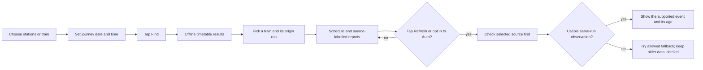
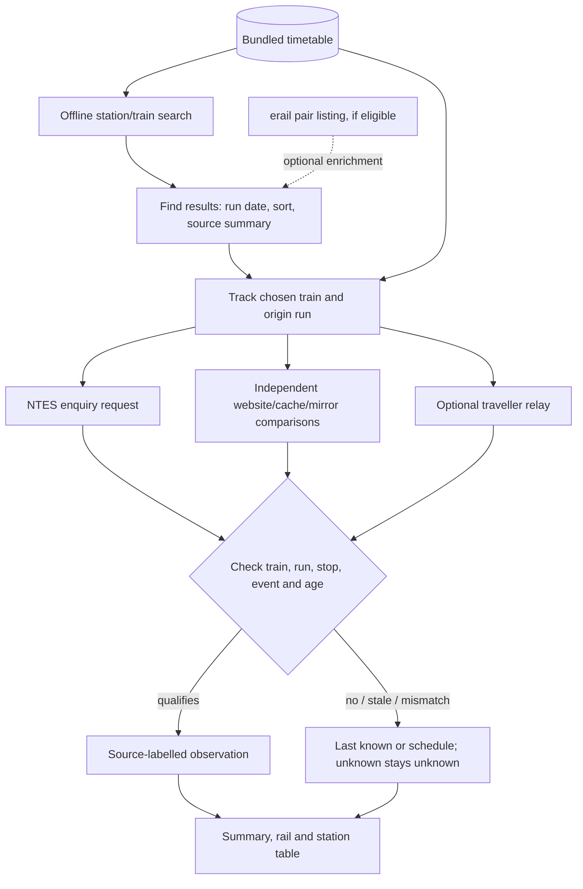

# TrackTrain — find a train, then understand its evidence

**TrackTrain** is an Android app for Indian Railways journeys. It carries a timetable on the phone for offline search and, when a network is available, asks external sources about a selected train. It **does not** have a guaranteed live-feed agreement or the same telemetry as the Where Is My Train phone app. A train's last reported station is not proof of its present location.

**Download the latest testing APK:** [app-debug.apk](https://github.com/tarungittarun/Checktrain02/releases/download/latest-apk/app-debug.apk). Check the [Android workflow](https://github.com/tarungittarun/Checktrain02/actions/workflows/android.yml) and the rolling release's commit/version notes before installing; the release link is replaced on each successful publication. This is a **debug/testing APK**, not a production release. It keeps the same debug signing key and package for in-place upgrades from R53 onward; production signing is separate. The [R130 checklist](docs/R130_CHECKLIST.md) records the last completed prior-version verification; a newer build should be judged by **its own** workflow results. The separate full E2E sweep is not implied by a green Android workflow.

## Start here: what a passenger sees

1. Choose **Stations** or **Train**, enter the journey, adjust its date and time, and tap **Find**. Editing text or picking a suggestion does **not** silently rerun the previous search. The train list can be sorted by departure, arrival or duration; the small blue summary names the result count and whatever source/date is actually known. The results have a thin gap so each train is a distinct tap target.
2. Tap a train to track it. The highlighted **SUMMARY BOX** gives the last supportable report, delay/next-stop information and a source label. The timetable remains available when a live request fails. Open **More/Less** for details.
3. Read the fixed **TIMETABLE | STATIONS | ACTUAL** header: scheduled times are not the same thing as reported arrival/departure times. Intermediate dots belong to the same distance-proportional rail; tap a leg to reveal them. Missing intermediate maps and unreported events remain missing, not fabricated.
4. Tap the blue, floating **Refresh** button for a new check, or drag it within the lower half of the tracking screen. **Auto · 1 min** is opt-in and runs only while the tracking screen is active. Settings offers **Follow system / Light / Dark**, a default tracking source, cache and diagnostics controls.



**In plain English:** the timetable answers *when it is scheduled*; a reported event answers *what one source last saw*. Neither a quick download nor a page's “last updated” label proves the train has moved. Green source availability is not automatically a verified actual arrival. **R132 safeguard:** selecting the undated Where Is My Train **website** displays its claim as a comparison, never as primary `ACTUAL` cells, delay, next halt or train marker. A site can answer while the train's position is still unknown; it is not the phone app. The [141-line diary audit](docs/R132_SOURCE_INTEGRITY_DESIGN.md) records exactly why.

## What the boxes and rail mean

| On screen | Meaning | Do **not** infer |
| --- | --- | --- |
| Timetable | Planned station times from the bundled reference data or an explicitly labelled source. | A train has actually arrived. |
| Actual / reported | A source-qualified observation for the selected train and origin run. A dash means no qualifying event. | Every future cell is known. |
| Train marker / freshness | Where the **last supportable report** belongs on the rail, with age from that event. | Continuous GPS, or motion since the last reported stop. |
| Source/page updated | When a provider says it published a page/feed. | That the train passed a station at that instant. |
| Summary and search count | What was found locally and which external source/date, if any, contributed. | That all results are live or that a source is contractually guaranteed. |

The tracking screen has a compact expandable summary, source selection (NTES and a clearly labelled **unverified website** in the user-facing selector), a fixed station-table heading, stop schedules and source-supported actuals. Website claims, estimates, crowd reports and old saved observations retain their labels rather than being silently folded into official actuals. The app can show an offline/last-known view when requests fail.

## How data reaches the screen



**For developers:** [`MainViewModel`](app/src/main/java/in/opentrack/india/ui/MainViewModel.kt) and [`TrainFinder`](app/src/main/java/in/opentrack/india/domain/TrainFinder.kt) handle local search and an optional, bounded erail pair enrichment. [`LiveViewModel`](app/src/main/java/in/opentrack/india/ui/LiveViewModel.kt) owns source selection, first-load survey, refresh/fallback and provenance; [`NtesWire`](app/src/main/java/in/opentrack/india/remote/NtesWire.kt), [`LiveProvider`](app/src/main/java/in/opentrack/india/remote/LiveProvider.kt) and [`PublicPageChecks`](app/src/main/java/in/opentrack/india/v2/mirror/PublicPageChecks.kt) implement request/parse seams. [`TrackModel`](app/src/main/java/in/opentrack/india/domain/TrackModel.kt) turns evidence into display rows. UI XML lives in [`app/src/main/res/layout`](app/src/main/res/layout), with paired day/night palette resources. The debug APK uses a stable, **test-only** key; it is not production-signing material ([build configuration](app/build.gradle)).

### External-source findings — audited 18 October 2026

These findings describe the inspected app and earlier recorded captures, **not** new probes or permission to access an undocumented feed. A publicly reachable response is not an access agreement. No sanitized capture from a current official NTES or Where Is My Train phone client was available, so exact request/response parity with those apps **has not been established**.

| Source | What we actually send / know | Limitation or sustainability risk |
| --- | --- | --- |
| **NTES enquiry** | A dated train-number POST to `AppServAnd` with an encrypted `jsonIn` envelope; an earlier owner-device log decoded timetable stops and reported minutes. The shape agrees with an [unofficial open-source client](https://github.com/x64vbhv/ntes-client), **not** a verified current official-app capture. | Train and IST origin date change; embedded framing constants and Android-11 user-agent do not. Protocol changes or restricted use could interrupt access. The separate mobile fallback warms a cookie; neither route proves permission. |
| **erail** | A bounded pair/by-number GET can supplement train-list identity; observed by-number answers did not establish verified running stop minutes. | Fixed request fields and old user-agent; no verified parity with an interactive browser session. |
| **RailYatri / ixigo** | Public JSON/SEO or HTML comparisons. RailYatri's date offset is dynamic but `user_id=-1` and `device_type_id=4` are fixed. | A page/update or root “arrived” claim does not establish a timestamped station event. Client contract/terms unverified. |
| **Where-is-my-train `.in` cache** | Separately labelled **experimental web cache**; dynamic date, train and route, fixed `appVersion` and `sb_version`. Wrong-run, ETA and inconsistent event cells are excluded. | Its answer has differed from the owner's fresher **phone-app** display. It must not be called that phone app's location or upgraded by guessing version/session IDs. |
| **`whereismytrain.org.in` website** | A page GET keyed by train number; **no origin-day parameter** in our URL. | The prior 20689 trial showed an old BDVT card, no SMET card and an unchanged page clock. That clock is not a SMET arrival. It is a distinct site from the `.in` cache and the phone app. |
| **ConfirmTkt / runningstatus.in** | Independent page/mirror comparisons, sometimes with a browser-rendered fallback. | Earlier direct 403 and zero corroborated halt claims show that reachability and evidence differ. A 403 is a refusal to respect, not a reason to disguise identity. |
| **ntfy traveller relay** | Public per-train topic and a changing poll cache-buster; opt-in reader reports are separate from railway telemetry. | Public relay availability, integrity, privacy and acceptable use are separate dependencies. |

**GUID example:** no GUID/UUID is sent by these status-request builders. That does **not** prove any provider requires one. NTES train/date and some cookies are dynamic; WIMT's `appVersion` and RailYatri's pseudo-user fields are fixed. We need an *authorized, sanitized real-client capture* to compare parameter lifecycles, response fields and run identity—not a fabricated GUID, replayed token, rotated identity or anti-bot workaround.

**Traffic finding:** first opening a tracking screen surveys several independent sources even when NTES answered; selected-source Refresh can fall back, and diagnostics can add requests after a refusal. One earlier **manual-use** diary had 24 logged HTTP attempts in roughly 75 seconds (nine `.org.in` GETs and seven NTES POSTs among them), excluding some other transports. This is **not** the idle-Auto rate. Auto ticks each minute when enabled on screen; some mirror/relay polls have 90-second local pacing, not a global per-provider quota. The generic HTTP layer stops retrying an HTTP error during that call, but there is no general persistent `429`/`Retry-After` budget. Before any wider rollout, obtain approved access and quotas, measure *all* requests per provider including retries, deduplicate checks, use respectful caching/backoff and treat 401/403/429 as controls to honor.

More evidence and source-specific caveats: [R62 source audit](docs/R62-source-audit.md), [R98 parallel-source readiness](docs/R98-parallel-source-readiness.md), [R129 website trial](docs/R129_CHECKLIST.md), and [R130 UI/CI checklist](docs/R130_CHECKLIST.md). The owner's every-minute phone-app observation remains **unexplained by these web sources**; do not infer the phone app's protocol or position semantics from a screenshot.

## Build, test and interpret the result

This repository uses Gradle, Android SDK 34, JDK 17 and Python 3 to prepare its offline timetable asset. The CI Android workflow produces the installable, stable-debug-signed APK; a push to this session branch builds, publishes a rolling APK, runs JVM/render tests and installed-APK traveller checks. The **separate full E2E workflow runs only when explicitly requested**, and a CI green result does not replace owner-phone testing or an access agreement.

```bash
# With a configured Android SDK and JDK 17:
./gradlew :app:assembleDebug :app:testDebugUnitTest
# Asset regeneration is handled by the build/CI preparation scripts; see tools/ci/prepare_asset.sh.
# On a deliberately connected device, when a full device run has been requested:
./gradlew :app:connectedDebugAndroidTest
```

Tests include offline search and date logic, parser/source facts, layout renders at narrow/large sizes, light/dark visibility checks, result-row spacing and selected-source journeys. The installed-APK matrix verifies the **published APK's bytes**, not a separately built substitute. See [Android workflow](.github/workflows/android.yml), [test flows](docs/E2E_FLOWS.md), and [testing card](docs/TEST_CARD.md). Always report the run ID and commit for results; old green runs do not validate a newly changed APK. A test render cannot verify touch feel or live-provider accuracy on the owner's phone.

## Known limitations and responsible next steps

- The bundled timetable is a snapshot. It supports offline search, not real-time cancellations or continuous movement.
- Past reports can stay unchanged while the train moves. A response arriving now is not a new station event. Avoid interpolated certainty between stops without independently supported position evidence.
- External sites may change, deny access or have incompatible terms. **Priority:** provider-approved feed/licence and published quotas, then authorized request/response comparison for the same run, respectful per-host pacing and explicit stale/unavailable states. No workaround based on copied identifiers or impersonation is recommended.
- Some intermediate maps are incomplete. A missing dot is not evidence of a non-stop; the UI should state uncertainty rather than manufacture a point.
- CI validates build, layouts and automated journeys; usability/colour on a real device and the owner's phone-app data comparison still require separate observation. The current branch's [PR #3](https://github.com/tarungittarun/Checktrain02/pull/3) must remain unmerged until the owner confirms the updated APK works.
